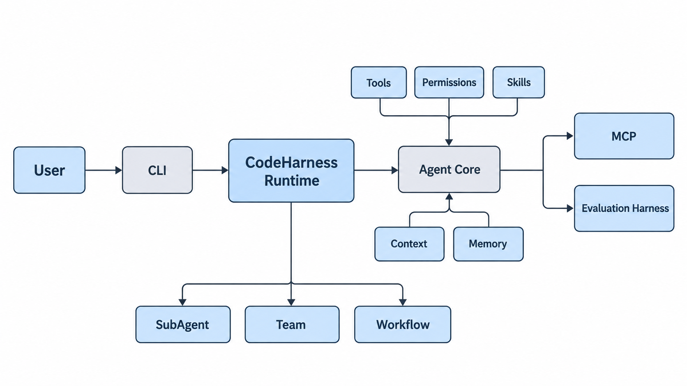
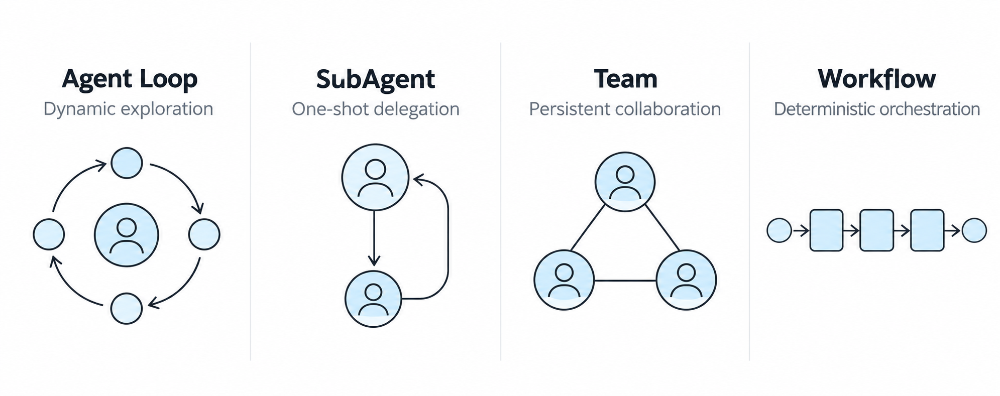
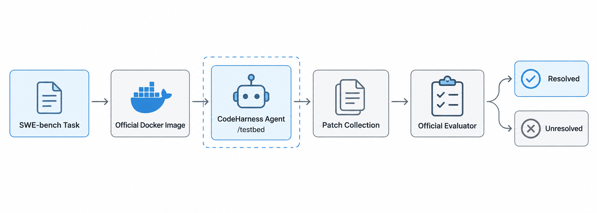

# CodeHarness

[English](README.md) | [简体中文](README.zh.md)

CodeHarness is a coding-agent runtime built from scratch to make the machinery around an LLM explicit: the agent loop, tools, approval boundaries, skills, context management, memory, task delegation, multi-agent coordination, deterministic workflows, and evaluation.

Version 1 focuses on a CLI-first runtime and reproducible software-engineering experiments. Its current stable SWE-bench Lite baseline resolves **205 of 300 tasks (68.3%)** with `deepseek-flash`.

> CodeHarness is an engineering and research project, not an OS-level sandbox. Its permission layer is a best-effort policy and approval boundary around tool execution.

## Core capabilities

- **Agent Loop and Tool Calling** — an OpenAI-compatible Chat Completions loop with coding tools, usage accounting, rejection handling, and bounded reactive recovery from context overflow.
- **Permission boundary** — workspace-aware path checks, hard-deny command patterns, approval-required operations, secret masking, and host-side MCP policy.
- **Skill system** — eager discovery of built-in, user, and project skills, with on-demand manifest loading into the agent workflow.
- **Context management** — token-budget thresholds, large-result externalization, transcript archival, consumed-result eviction, semantic checkpoints, and manual or reactive compaction.
- **Persistent memory** — relevance-based recall, post-turn extraction, and consolidation of project, user, feedback, and reference memories.
- **Tasks, background work, and scheduling** — a file-backed dependency graph, background shell execution, and durable or in-memory cron delivery.
- **SubAgent and Team** — one-shot delegation plus session-persistent teammates with mailboxes, a shared task board, optional plan approval, and optional Git worktrees.
- **MCP integration** — stdio server discovery, tool-schema adaptation, lifecycle management, namespaced tools, and ask-by-default authorization.
- **Workflow runtime** — validated Agent, Tool, Parallel, Pipeline, and nested Workflow steps with asynchronous execution, journals, snapshots, resume, timeouts, and resource limits.
- **Evaluation harness** — isolated smoke cases and a single-instance SWE-bench adapter that captures patches and can invoke the official evaluator explicitly.

## Architecture



`codeharness/app.py` is the composition root. It builds one leader runtime, registers native and MCP tools, connects persistence paths, and coordinates the scheduler, teammates, workflows, and shutdown lifecycle. Tool calls pass through a shared execution boundary before reaching their handlers.

For module boundaries, state locations, and implementation caveats, see [Architecture](docs/architecture.md).

## Execution models



| Model | Best suited for | Runtime behavior |
| --- | --- | --- |
| **Agent Loop** | Open-ended coding work | The leader alternates between model decisions and tool results until it returns a final answer or a goal gate stops the turn. |
| **SubAgent** | One self-contained delegation | A child agent runs with isolated conversation context and a bounded number of rounds, then returns one result to the caller. |
| **Team** | Coordinated work across tasks | Session-persistent teammate threads share a task graph and file-backed mailboxes; worktrees can separate Git working directories. |
| **Workflow** | Repeatable multi-step procedures | A validated definition combines agent and tool steps with deterministic control flow, persisted run state, and resume support. |

## Quick start

### Requirements

- Conda
- Python 3.11 or newer
- Git
- An OpenAI-compatible Chat Completions endpoint
- Docker only when running the SWE-bench adapter

### Install

```bash
git clone https://github.com/sweeter-byte/CodeHarness.git
cd CodeHarness

conda create -n codeharness python=3.11 -y
conda activate codeharness
python -m pip install -r requirements.txt
```

Copy the environment template and configure the three required provider values:

```bash
cp .env.example .env
```

```dotenv
DEEPSEEK_API_KEY=your-api-key
DEEPSEEK_BASE_URL=https://your-openai-compatible-endpoint/v1
DEEPSEEK_MODEL_ID=your-model-id
```

Start the interactive CLI:

```bash
python main.py
```

The CLI provides `/context`, `/compact`, `/clear`, and `/goal`. MCP is optional: copy and edit [`mcp_servers.example.json`](mcp_servers.example.json), then set `MCP_CONFIG_PATH` or place the file at `~/.codeharness/mcp/servers.json`. Disable any example server whose executable or credentials are not configured.

## Evaluation



| Configuration | Dataset | Resolved | Resolve rate | Interpretation |
| --- | ---: | ---: | ---: | --- |
| CodeHarness v1 + `deepseek-flash` | SWE-bench Lite (300) | **205 / 300** | **68.3%** | Current stable baseline |
| CodeHarness v1 + Pro | SWE-bench Lite (300) | **162 / 300** | **54.0%** | Completed comparison run; 57 Worker API exceptions |

The Pro result is not a clean model-capability comparison: 57 tasks encountered Worker API exceptions during that run. The raw rates should therefore not be used to conclude that Pro is inherently weaker than Flash.

The repository also includes small smoke cases whose success is determined by an independent verifier, not by the agent's final message. See [Evaluation](docs/evaluation.md), [`evals/README.md`](evals/README.md), and [`evals/swebench/README.md`](evals/swebench/README.md) for commands, artifacts, and scope.

## Repository layout

```text
CodeHarness/
├── codeharness/          # Runtime, agent core, tools, safety, state, teams, workflows
├── interfaces/           # Interactive terminal interface
├── evals/                # Smoke harness and SWE-bench adapter
├── tests/                # Runtime and integration tests
├── docs/                 # Architecture, evaluation notes, and README images
├── main.py               # CLI entry point
└── mcp_servers.example.json
```

## Current boundaries

- The permission system is a policy and approval layer, not kernel-enforced isolation.
- MCP server execution currently supports stdio transport; streamable HTTP is accepted by configuration but not implemented by the client.
- Team conversations live for the current process; task and mailbox files persist, but teammate model context is not resumable.
- The SWE-bench adapter processes exactly one instance per invocation. Batch execution, concurrency, retries, pass@k, and leaderboard tooling are not implemented.
- Context sizes are estimated between provider usage reports, and semantic compaction is intentionally lossy.

## Roadmap

CodeHarness v1 has completed its core runtime and benchmark baseline. The next iteration will focus on stronger diagnosis and verification, better convergence on long trajectories, cleaner patches, and more robust evaluation infrastructure. These are roadmap items, not current capabilities.

## Documentation

- [Architecture](docs/architecture.md)
- [Evaluation methodology and results](docs/evaluation.md)
- [Evaluation harness](evals/README.md)
- [SWE-bench adapter](evals/swebench/README.md)
