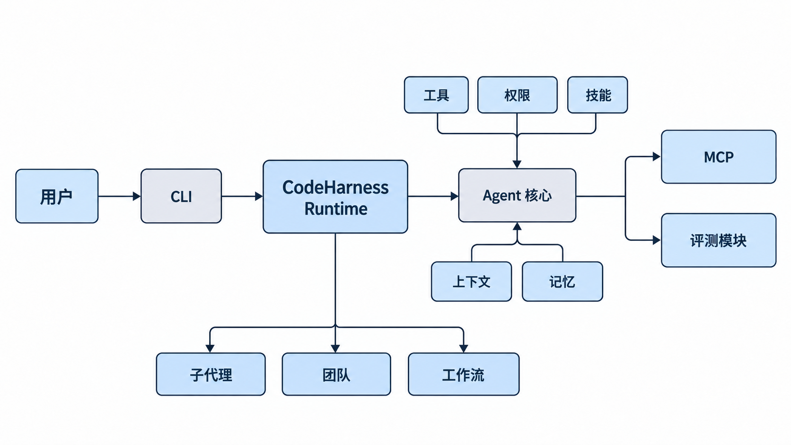
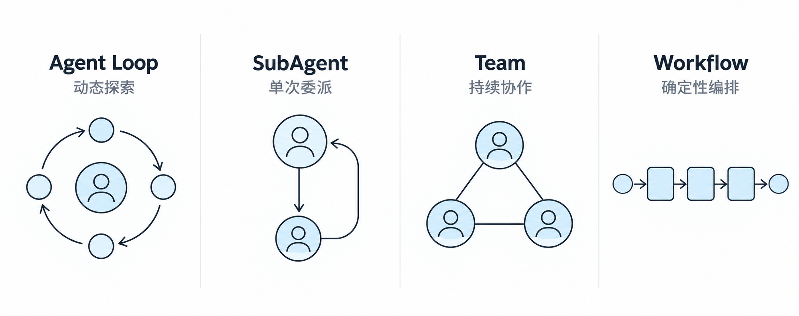
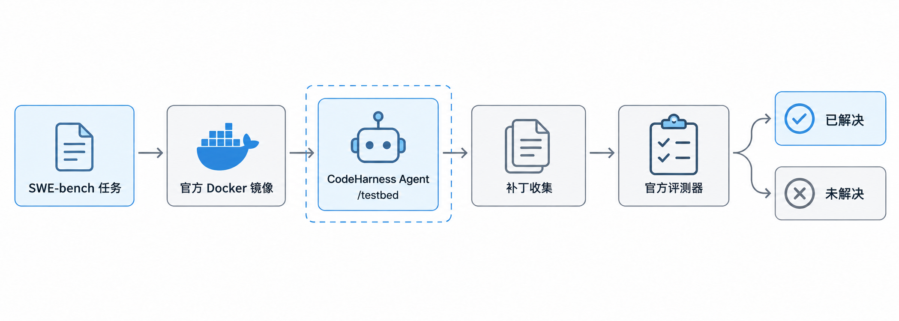

# CodeHarness

[English](README.md) | [简体中文](README.zh.md)

CodeHarness 是一个从零实现的 Coding Agent Runtime。项目将 LLM 周围的运行机制显式拆分为 Agent Loop、工具、审批边界、技能、上下文管理、记忆、任务委派、多 Agent 协作、确定性工作流和评测模块，便于独立理解、验证与演进。

v1 当前聚焦于 CLI 运行时与可复现的软件工程实验。使用 `deepseek-flash` 的稳定 SWE-bench Lite 基线已解决 **205 / 300 个任务（68.3%）**。

> CodeHarness 是工程与研究项目，不是操作系统级沙箱。权限层是在工具执行前实施的尽力检查与用户审批边界。

## 核心能力

- **Agent Loop 与 Tool Calling**：基于 OpenAI 兼容 Chat Completions 接口，支持编码工具、用量统计、连续拒绝停止，以及上下文溢出后的有限恢复。
- **权限边界**：工作区路径检查、危险命令拒绝规则、需审批操作、敏感信息掩码，以及 MCP 主机侧策略。
- **技能系统**：启动时发现内置、用户和项目技能，并按需将技能清单载入 Agent 工作流。
- **上下文管理**：基于 Token 预算的阈值、大结果外置、历史归档、已消费结果淘汰、语义检查点，以及手动或异常触发的压缩。
- **持久记忆**：按相关性召回，在正常回合结束后提取，并合并项目、用户、反馈和参考类记忆。
- **任务、后台执行与调度**：文件持久化的任务依赖图、后台 Shell 命令，以及持久或仅驻留内存的 Cron 交付。
- **SubAgent 与 Team**：单次委派，以及通过邮箱和共享任务板协作的会话期常驻 Teammate；可选计划审批和 Git Worktree。
- **MCP 集成**：stdio Server 发现、工具 Schema 适配、生命周期管理、命名空间，以及默认需审批的授权策略。
- **Workflow Runtime**：经校验的 Agent、Tool、Parallel、Pipeline 和嵌套 Workflow 步骤，支持异步执行、日志、快照、恢复、超时和资源限制。
- **评测框架**：隔离运行的小型 Smoke Case，以及能够收集补丁并显式调用官方评测器的单实例 SWE-bench 适配器。

## 系统架构



`codeharness/app.py` 是运行时的组合根：创建 Leader，注册原生与 MCP 工具，连接持久化路径，并协调调度器、Teammate、Workflow 和退出流程。每次工具调用都会先经过统一的执行与权限边界，再进入具体处理函数。

模块边界、状态位置和实现限制详见[架构说明](docs/architecture.zh.md)。

## 执行模型



| 模型 | 适用场景 | 运行方式 |
| --- | --- | --- |
| **Agent Loop** | 开放式编码任务 | Leader 在模型决策与工具结果之间循环，直至给出最终回答或由 Goal Gate 终止当前回合。 |
| **SubAgent** | 单个可独立委派的子任务 | 子 Agent 使用隔离的对话上下文和有限执行轮数，完成后向调用方返回一次结果。 |
| **Team** | 多任务协调执行 | 会话期常驻的 Teammate 线程共享任务图与文件邮箱；可使用 Worktree 分离 Git 工作目录。 |
| **Workflow** | 可重复的固定流程 | 经过校验的定义组合 Agent 与工具步骤，通过确定性控制流、持久化运行状态和恢复机制执行。 |

## 快速开始

### 环境要求

- Conda
- Python 3.11 或更高版本
- Git
- OpenAI 兼容的 Chat Completions 服务
- 仅在运行 SWE-bench 适配器时需要 Docker

### 安装

```bash
git clone https://github.com/sweeter-byte/CodeHarness.git
cd CodeHarness

conda create -n codeharness python=3.11 -y
conda activate codeharness
python -m pip install -r requirements.txt
```

复制环境变量模板，并填写三个必需的模型服务配置：

```bash
cp .env.example .env
```

```dotenv
DEEPSEEK_API_KEY=your-api-key
DEEPSEEK_BASE_URL=https://your-openai-compatible-endpoint/v1
DEEPSEEK_MODEL_ID=your-model-id
```

启动交互式 CLI：

```bash
python main.py
```

CLI 提供 `/context`、`/compact`、`/clear` 和 `/goal`。MCP 为可选配置：复制并编辑 [`mcp_servers.example.json`](mcp_servers.example.json)，然后设置 `MCP_CONFIG_PATH`，或将文件保存到 `~/.codeharness/mcp/servers.json`。没有准备对应可执行程序或凭据时，应禁用示例中的相关 Server。

## 评测结果



| 配置 | 数据集 | 已解决 | 解决率 | 说明 |
| --- | ---: | ---: | ---: | --- |
| CodeHarness v1 + `deepseek-flash` | SWE-bench Lite（300） | **205 / 300** | **68.3%** | 当前稳定基线 |
| CodeHarness v1 + Pro | SWE-bench Lite（300） | **162 / 300** | **54.0%** | 已完成对照实验；存在 57 次 Worker API 异常 |

Pro 轮不是一次无干扰的模型能力对比：其中 57 个任务遇到了 Worker API 异常。因此，不能仅根据两组原始解决率得出“Pro 模型能力弱于 Flash”的确定结论。

仓库还包含一组小型 Smoke Case，其成功与否由独立验证命令决定，而不是由 Agent 的最终回答决定。运行命令、产物和适用范围详见[评测说明](docs/evaluation.zh.md)、[`evals/README.md`](evals/README.md)和 [`evals/swebench/README.md`](evals/swebench/README.md)。

## 项目结构

```text
CodeHarness/
├── codeharness/          # 运行时、Agent 核心、工具、安全、状态、Team 与 Workflow
├── interfaces/           # 交互式终端界面
├── evals/                # Smoke 评测框架与 SWE-bench 适配器
├── tests/                # 运行时与集成测试
├── docs/                 # 架构、评测说明与 README 配图
├── main.py               # CLI 入口
└── mcp_servers.example.json
```

## 当前边界

- 权限系统是策略与审批层，不提供内核级隔离。
- MCP Server 当前仅支持 stdio 传输；配置层接受 streamable HTTP，但客户端尚未实现。
- Team 的对话状态仅存在于当前进程；任务和邮箱文件可以持久化，但 Teammate 的模型上下文不能恢复。
- SWE-bench 适配器每次只处理一个实例，尚未实现批量、并发、重试、pass@k 和排行榜工具。
- 两次服务端用量报告之间的上下文大小依靠估算；语义压缩是有损过程。

## 后续方向

CodeHarness v1 已完成核心运行能力与 benchmark 基线。下一阶段将重点改进诊断与验证、长轨迹收敛、Patch Hygiene 和评测基础设施的稳定性。这些内容属于后续计划，不代表当前已经实现。

## 相关文档

- [架构说明](docs/architecture.zh.md)
- [评测方法与结果](docs/evaluation.zh.md)
- [评测框架](evals/README.md)
- [SWE-bench 适配器](evals/swebench/README.md)
